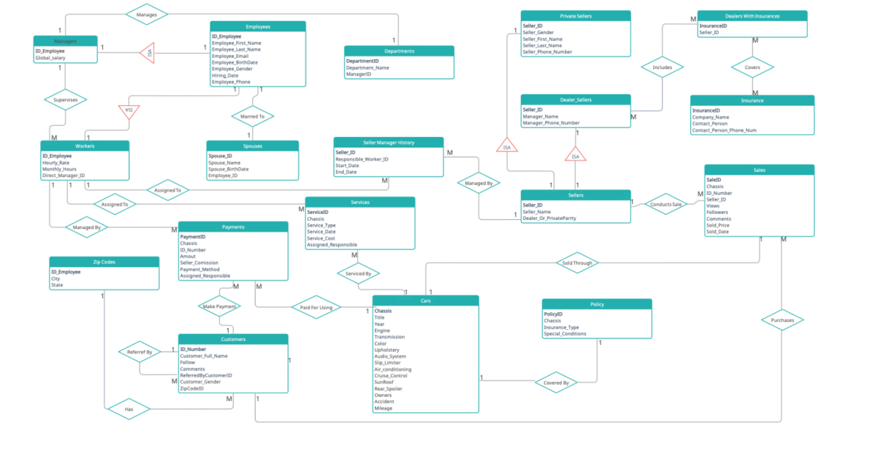
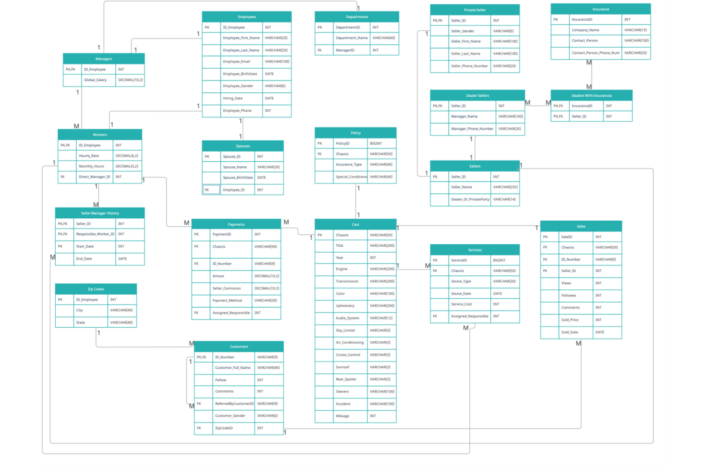

# Porsche Sales Database 🏎️

A relational database for managing a Porsche car-sales business, end to end: from listing a car, through the sale, to insurance, service history and payments.
Designed and built in **SQL Server (T-SQL)** as part of the *Advanced Database Analysis & Design* course at HIT – Holon Institute of Technology (2025).

**Skills shown:** data modeling (ERD), normalization to 3NF, constraints and referential integrity, inheritance (ISA) modeling, recursive relationships, and analytical SQL (CTEs, subqueries, multi-table joins, CASE, set operations).

---

## 📊 At a glance

| | |
|---|---|
| **Tables** | 18 |
| **Rows of seed data** | ~58,000 |
| **Largest tables** | Customers (15K), Services (13.7K), Cars / Sales / Payments / Policies (~4.5K each) |
| **Analysis queries** | 12 |
| **Engine** | Microsoft SQL Server |

---

## 🗂️ Data model



<details>
<summary>Physical diagram (columns and data types)</summary>



</details>

### Main entities

| Area | Tables |
|---|---|
| People and organization | `Employees` → `Managers` / `Workers` (ISA), `Spouses`, `Departments` |
| Sellers | `Sellers` → `Dealer_Sellers` / `Private_Seller` (ISA), `Seller_Managers_History` |
| Customers | `Customers` (self-referencing referral link), `ZipCodes` |
| Cars and transactions | `CARS`, `Sales`, `Payments` |
| After the sale | `Policy`, `Services`, `Insurance`, `DealersWithInsurances` (many-to-many) |

### Design decisions

- **Inheritance (ISA):** `Managers` and `Workers` share a primary key with `Employees`; `Dealer_Sellers` and `Private_Seller` do the same with `Sellers`.
- **Recursive relationships:** a worker reports to a manager (`Direct_Manager_ID`), and a customer can be referred by another customer (`ReferredByCustomerID`).
- **History tracking:** `Seller_Managers_History` uses a composite key (seller, worker, start date) to keep who was responsible for each seller over time.
- **Data integrity:** `CHECK` constraints (gender, Yes/No flags, payment method, service cost 0–3,000, non-negative amounts), `UNIQUE` emails and phone numbers, `DEFAULT GETDATE()` dates.
- **Safe deletes:** `ON DELETE SET NULL` when a manager leaves (department and workers are kept); `ON DELETE CASCADE` from an employee to their spouse record.
- **Custom IDs:** `IDENTITY` with custom seeds and steps for policies, services and payments.

---

## 🔍 Analysis queries

All in [`sql/03_analysis_queries.sql`](sql/03_analysis_queries.sql):

| # | Business question | Technique |
|---|---|---|
| 1 | Which sellers had an average sale price above the overall average in 2022? | Chained CTEs |
| 2 | Turbo models with private-only ownership and under 20,000 miles | `LIKE` patterns, `BETWEEN` |
| 3 | Total sales revenue per West Coast state | 3-table `JOIN`, `GROUP BY` |
| 4 | Required inspection frequency for each car, based on its age | `CASE` |
| 5 | Cars whose total service cost is above the average | Subquery in `HAVING` / `FROM` |
| 6 | The most expensive service for each car | Derived table + `JOIN` |
| 7 | Number of buying customers per East Coast state | `COUNT(DISTINCT)` |
| 8 | Sellers who never made a sale | `EXCEPT` |
| 9 | Dealers insured by insurance company 1 or 2 | `UNION` |
| 10 | Revenue by year | Date functions, aggregation |
| 11 | Sellers with over $1M in total sales | `HAVING` |
| 12 | Cars under 4 years old with comprehensive insurance | `INTERSECT` |

Example (query 1):

```sql
WITH Sales2022 AS (
    SELECT Seller_ID, Sold_Price
    FROM Sales
    WHERE YEAR(Sold_Date) = 2022
),
AveragePerSeller AS (
    SELECT Seller_ID, AVG(Sold_Price) AS Average_Sale_Price
    FROM Sales2022
    GROUP BY Seller_ID
),
OverallAverage AS (
    SELECT AVG(Sold_Price) AS Overall_Average_Price
    FROM Sales2022
)
SELECT aps.Seller_ID, aps.Average_Sale_Price
FROM AveragePerSeller aps
CROSS JOIN OverallAverage oa
WHERE aps.Average_Sale_Price > oa.Overall_Average_Price;
```

---

## ▶️ How to run

1. Open SQL Server Management Studio (or Azure Data Studio).
   - **On macOS:** SQL Server doesn't install natively, so run it in Docker and connect with Azure Data Studio:
     ```bash
     docker run -e "ACCEPT_EULA=Y" -e "MSSQL_SA_PASSWORD=<YourStrong!Passw0rd>" \
       -p 1433:1433 --name sqlserver -d mcr.microsoft.com/mssql/server:2022-latest
     ```
     Then connect to `localhost,1433` with user `sa`.
2. Run, in this order:
   - `sql/01_schema.sql` – creates the `Porsche` database and all tables
   - `sql/02_seed_data.sql` – loads the sample data (large file, takes a minute)
   - `sql/03_analysis_queries.sql` – the analysis queries

## 📁 Repository structure

```
porsche-sales-database/
├── README.md
├── sql/
│   ├── 01_schema.sql            # DDL: tables, keys, constraints
│   ├── 02_seed_data.sql         # sample data
│   └── 03_analysis_queries.sql  # 12 business queries
└── docs/
    ├── project_report_he.pdf    # full design report (Hebrew)
    └── images/                  # ERD diagrams
```

> All people, ID numbers, phone numbers and emails in the sample data are fictional.

## 🛠️ How I built it

I designed and built the entire project myself: the conceptual, logical and physical models, the schema and constraints, the sample data and all 12 analysis queries.

A few real-world problems I had to solve along the way:

- **Running SQL Server on a Mac.** Microsoft SQL Server has no native macOS install, so I ran it in a **Docker** container and worked against it through **Azure Data Studio**.
- **Loading the data without an Excel import.** The sample data lived in Excel, and there was no way to import an Excel file in that setup. Working with an **AI assistant (Claude)**, I turned the spreadsheets into generated **`INSERT` scripts** – about **6,000 statements and ~58,000 rows** across all tables (`sql/02_seed_data.sql`) – and loaded the data that way.
- **Checking the results.** I used AI to cross-check query outputs and catch edge cases, and validated the results against manual calculations.

## 👤 Author

**Kfir Shary** – [GitHub](https://github.com/kfirsh97)
